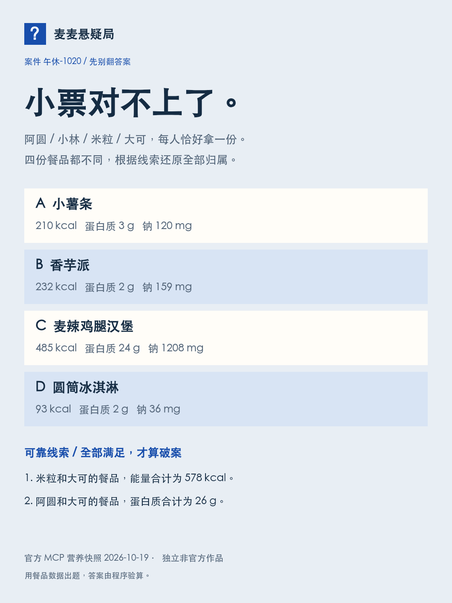

# 麦麦悬疑局 · The Receipt Files

**餐品没丢，小票对不上了。** 四个朋友各拿一份餐品，你能根据留下的线索，还原每个人拿了什么吗？


一个把麦当劳中国 MCP 营养数据变成**有唯一解的小票推理案**的 Skill。适合午休独自玩、朋友之间出题，也适合想研究“真实数据如何生成可验证游戏”的开发者。无需购买餐品、无需读取个人订单。

**[下载 play.html 后双击试玩](play.html)** · [Skill 指令](SKILL.md) · [真实 MCP 集成](MCP_INTEGRATION.md) · [验证记录](docs/VALIDATION.md)

> 独立参赛作品，非麦当劳官方产品。默认素材为北京时间2026-10-19 23:26:57取得的真实营养快照，不表示某门店当前在售。虚构数据模式单独标记。数字用于逻辑游戏，不构成饮食建议。

## 先玩这一题



四人：阿圆、小林、米粒、大可。每人恰好拿一份，四份不能重复。表里的数值是每份餐品参考值，不是人体检测结果。题面中的线索全部可靠。

<details><summary>我想核对答案（剧透）</summary>

米粒与大可的餐品能量合计578 kcal，只有麦辣鸡腿汉堡485与圆筒冰淇淋93符合。阿圆与大可蛋白质合计26g；若大可拿冰淇淋2g，阿圆就必须拿汉堡24g，但汉堡已归米粒，违反不能重复。因此大可拿汉堡，阿圆拿香芋派，米粒拿冰淇淋，小林拿小薯条。

</details>

## 怎么玩

1. 打开 `play.html`，或启动本机服务。
2. 看四款餐品数据，读全部线索，在右侧给四个人分配餐品。
3. 提交推理；答案没对上可以继续试，也可以请求提示或查看解答。
4. 下载不含答案的 PNG 案件卡，给朋友留一题。

“今日同题”使用北京时间日期作为编号；“换一桩案子”生成新编号。固定内置数据包、编号和版本会复现同一题。自定义包需连同 JSON 分享；本机地址无法让远程朋友访问，公开部署后才能直接分享网页链接。

## 安装与运行

**只想玩：** 下载仓库里的 `play.html`，在桌面浏览器打开即可。所有必需样式、代码、内置快照都已打包，不加载远程字体或脚本。

**开发与本机服务：** Node.js 20+，没有第三方运行依赖，不需要 `npm install`。

```bash
npm start
```

打开终端显示的 `http://127.0.0.1:4318`。服务仅监听本机；Ctrl+C 停止。也可以将整个项目放在静态站点，使用根目录 `index.html` 进入游戏。GitHub Pages 选择 `main / (root)` 后即可托管；这是部署选项，并不表示本包已上线。

**作为 Agent Skill：** 将整个目录放到你的客户端支持的技能目录，或通过客户端导入 `SKILL.md` 及相邻资源。不同客户端技能目录与环境变量语法不同，请按其实际说明配置。对 Agent 说：

> 用麦麦悬疑局给我出一桩午休案，先别告诉我答案。
>
> 用真实麦当劳营养数据刷新素材，编号叫“周二午休”，然后生成给朋友的挑战卡。

## MCP 为什么不可替代

数据决定题目，程序决定答案：

```text
官方 list-nutrition-foods → 规范化每份数据 → 选择四款餐品
        → 构造数值线索 → 枚举24种归属 → 唯一解才发布
        → 玩家作答 → 验证/提示/解释 → 不剧透分享卡
```

本轮真实调用返回160行记录，白名单提取16款常见餐品。代码不编造营养值，不调用个人订单、优惠券或交易接口。白名单仅保留营养查询与时间查询；详见 [MCP_INTEGRATION.md](MCP_INTEGRATION.md)。

## 刷新官方快照

在本机环境配置 `MCD_MCP_TOKEN`，不要把 Token 写入代码或命令行参数。首次申请与协议确认在[官方开放平台](https://open.mcd.cn/mcp)完成。

```bash
node scripts/mcp.mjs --discover
node scripts/mcp.mjs --tool list-nutrition-foods --args '{}' --output private/nutrition-response.json
node scripts/normalize-nutrition.mjs private/nutrition-response.json examples/official-pack.json
node scripts/build-standalone.mjs
```

示例配置见 `mcp-config.example.json`，仅含环境变量占位符。原始响应只放 `private/`；公开资料仅保留餐品白名单字段。接口错误时明确失败，不用虚构结果冒充成功。

注意：刷新数据后同一案件编号可能生成不同题，保留旧数据包才能复现历史挑战。

## 验证与结构

```bash
npm test
node scripts/build-case.mjs --input examples/official-pack.json --seed 午休-1020 --output examples/case.json
```

当前10组测试通过，其中真实快照与虚构资料各覆盖500个种子，检查唯一解、真线索、答案正确性、确定性和无冗余线索；另验证口径、缺失字段、只读白名单、HTTP错误及SSE协议处理。测试不代表真实用户规模或偏好验证。

```text
SKILL.md                  Agent执行规则
lib/puzzle.mjs            确定性出题与求解器
lib/mcp-client.mjs        只读MCP客户端
scripts/                  查询、规范化、生成案件、单文件构建
web/                      多端交互与PNG导出
play.html                 双击即可玩的单文件
examples/                 明确标来源的官方快照和虚构示例
```

## 作品边界与贡献

没有远程多人房间、玩家排行榜、后台定时刷新或自动下单。试玩数据随包提供，本机刷新才会调用 MCP。角色和故事为虚构，不根据餐品推断现实用户的健康、人格或道德。

欢迎提交：难度反馈、显示问题、生成器反例、可复现测试。觉得这种“真实数据变成小游戏”的方向有意思，可以给仓库一个 Star，方便以后找到。不要把 Star 作为试玩或答案的解锁条件。

原创源码使用 MIT License；麦当劳品牌、接口、餐品数据及系统字体/Emoji权利归各自权利人，不因本许可证获得转授权。AI（Codex）辅助研究、编码与素材制作。未使用 WorkBuddy，不提交虚构的 `workbuddy.md`。
